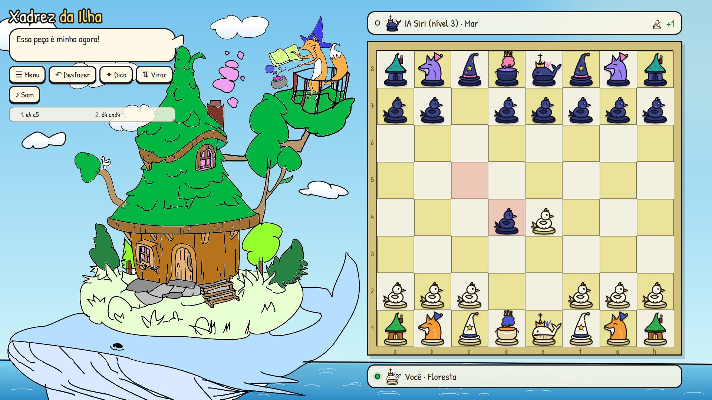
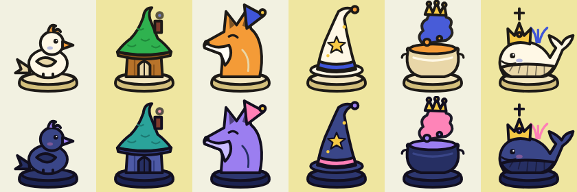
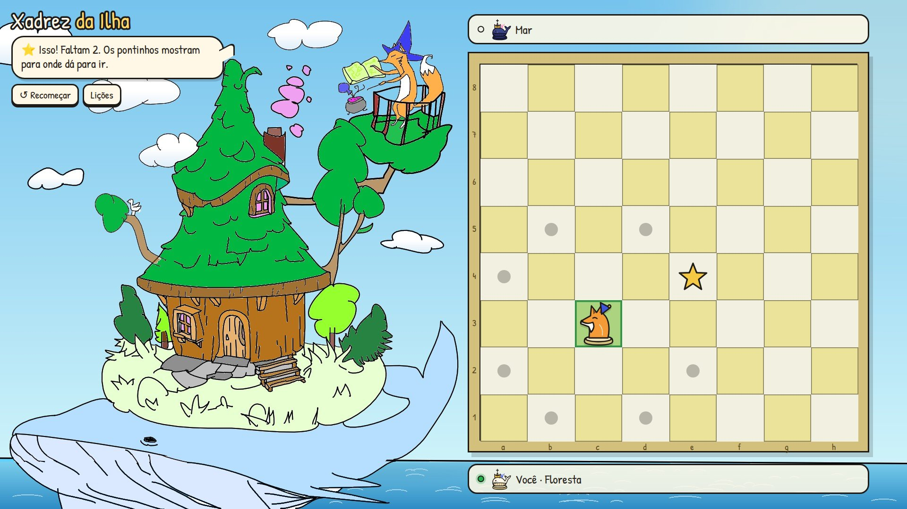

# ♟️ Xadrez da Ilha

Jogo de xadrez completo para o navegador, ambientado numa ilha que fica nas costas de uma baleia. A Raposa Maga ensina e comenta as partidas. O cenário e as peças foram feitos a partir de uma ilustração minha.

**▶ Jogar online:** https://foxylyv.github.io/xadrez-da-ilha/



## Linguagens e tecnologias

| | Uso |
|---|---|
| **JavaScript** (puro, sem bibliotecas) | Regras, IA, interface e tutorial |
| **HTML + CSS** | Estrutura da página e visual (paleta tirada da ilustração) |
| **SVG** | As 12 peças, desenhadas em código |
| **Python** (Pillow + NumPy) | Ferramentas para ler o arquivo do Krita (.kra) e tratar a arte |
| **Node.js** | Testes automáticos das regras, da IA e do tutorial |

Não tem servidor nem instalação: abra o `index.html` e já dá para jogar.

## Modos de jogo

- **Partidas infinitas**: uma partida atrás da outra. Quando você ganha, a IA sobe de nível; quando perde, ela desce. As cores alternam a cada partida.
- **Contra a IA**: 10 níveis, do *Girino* à *Baleia Anciã*.
- **Dois jogadores** na mesma tela.
- **Tutorial**: 14 lições interativas (cada peça, captura, xeque, mate, roque, en passant, promoção e empates).

| Peça clássica | Na ilha |
|---|---|
| Peão | Passarinho |
| Torre | Casinha da árvore |
| Cavalo | Raposa |
| Bispo | Chapéu de mago |
| Rainha | Caldeirão mágico |
| Rei | Baleia coroada |



## Resumo da lógica

### Regras — `js/regras.js`
- O tabuleiro é um vetor de 64 casas (`linha × 8 + coluna`), e as posições entram e saem em notação **FEN**.
- Os lances são gerados em duas etapas. Primeiro os **pseudo-legais** (o jeito de andar de cada peça); depois cada um é jogado e desfeito para checar se deixou o próprio rei em xeque. Só os seguros viram lances **legais**.
- Inclui roque, en passant, promoção, xeque-mate, afogamento, regra dos 50 lances, repetição tripla (com hash **Zobrist**) e material insuficiente.
- Validado com **perft**, o teste padrão de motores de xadrez: o resultado bate com os valores conhecidos em 5 posições clássicas.

### IA — `js/ia.js`
- **Avaliação**: soma o material (peão 100 … rainha 900) e um bônus por posição, com uma tabela de 64 casas para cada peça.
- **Busca**: negamax com **poda alfa-beta**, aprofundamento iterativo com limite de tempo, quiescência (continua olhando as capturas para não parar no meio de uma troca), ordenação MVV-LVA, killer moves e tabela de transposição.
- **Níveis**: cada nível muda a profundidade, o tempo e um "ruído" aleatório nas notas, que faz a IA errar de propósito nos níveis fáceis.

### Interface — `js/jogo.js`
- Um palco fixo de 1920×1080, igual à ilustração, escalado para caber em qualquer tela.
- Cada peça recebe um id, que acompanha os lances. Assim o deslizar das peças é animado, incluindo o roque e o en passant.
- Dá para clicar ou arrastar (*pointer events*, funciona com mouse e toque). Os sons são gerados com Web Audio.
- A partida é salva no `localStorage` (FEN inicial + lista de lances). Ao continuar, os lances são refeitos a partir do início.

### Tutorial — `js/tutorial.js`
As lições são só dados (posição, objetivo e texto). Nas lições de "pegue as estrelas" o adversário não joga, e cada estrela aparece só depois da anterior, sempre a um lance de distância.



## Estrutura

```
index.html        página do jogo
css/estilo.css    visual
js/regras.js      regras do xadrez
js/ia.js          inteligência artificial
js/pecas.js       peças em SVG
js/tutorial.js    lições
js/jogo.js        interface
arte/             cenário
ferramentas/      scripts Python de tratamento da arte
testes/           testes em Node.js
```

```bash
node testes/perft.js           # regras
node testes/ia_teste.js        # IA
node testes/tutorial_teste.js  # tutorial
```

## Créditos

Ilustração, conceito e peças: **Lívia Souza** ([@Foxylyv](https://github.com/Foxylyv)). A arte não pode ser reutilizada sem autorização.
